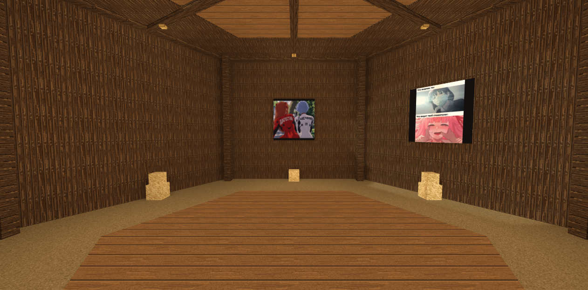
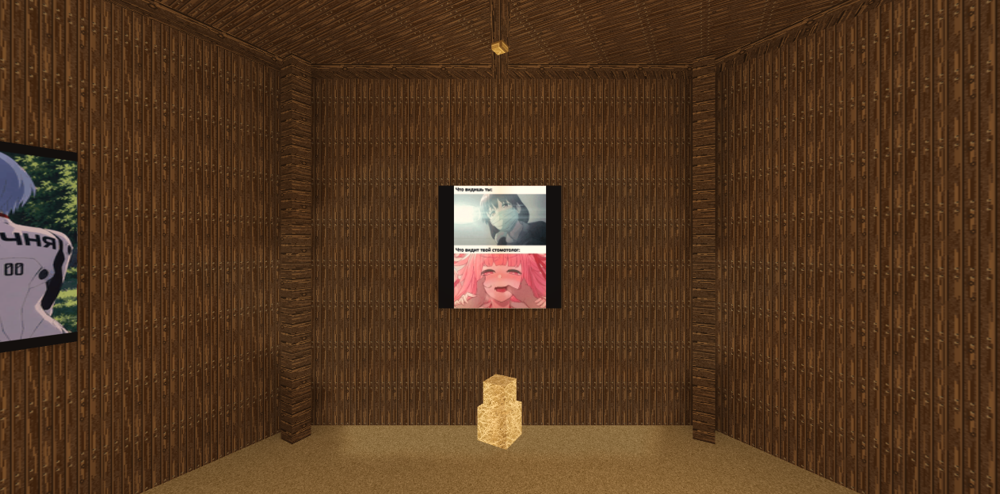
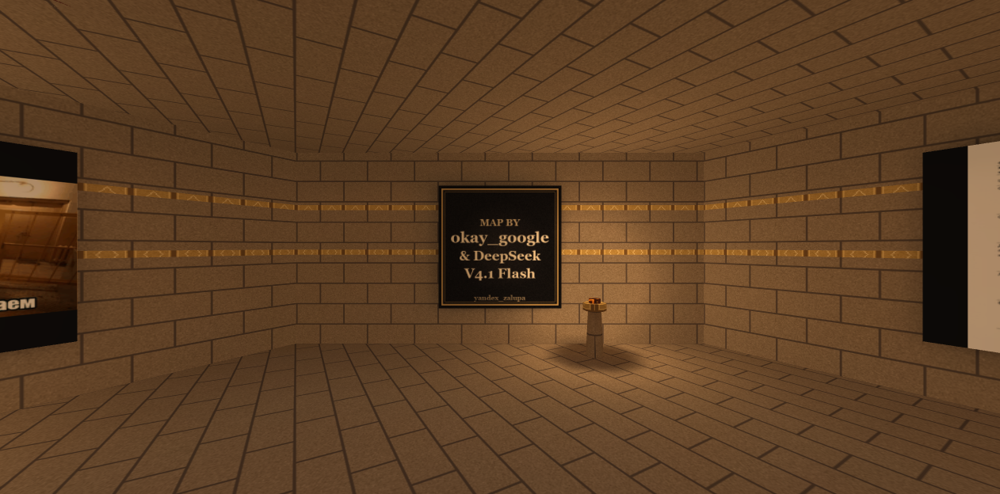
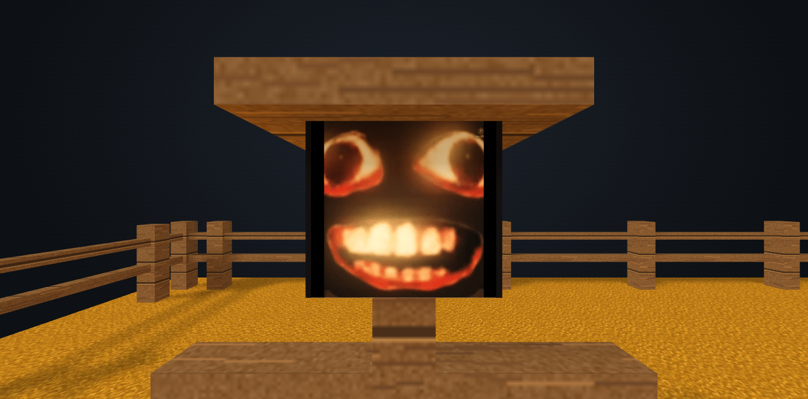

# yandex_zalupa

Adventure-карта для Counter-Strike 1.6: пять этапов, стог сена из 204 тюков и иголка, которую нужно найти и сломать ножом.

Карта рассчитана на сервер с AMX Mod X 1.9 и режим с 32 игроками на стороне КТ. Проходится одним игроком без платных усилений, но поддерживает и группу.

## Что внутри

- Пять последовательных испытаний: поле → сеновал → мельничный подвал → пещера → огненный зал. После пятого — финальный зал с пьедесталом под награду.
- 204 тюка на этап, одна скрытая иголка, послойное разрушение сена, открытие пола в следующую комнату.
- Телепорт на поле вместо батута: пять случайных точек над стогом.
- Своё небо с гигантом в облаках, 18 собственных текстур, 21 мем-фото на стенах и табличка авторов в финальном зале.
- Полный расчёт видимости: клиент рисует около 31% карты вместо 86%.

## Скриншоты






Остальные кадры — в папке `screenshots/`.

## Требования

- Counter-Strike 1.6 (GoldSrc).
- AMX Mod X 1.9 с модулями `fakemeta` и `hamsandwich`. ReAPI не требуется.
- Лимит edict желательно не ниже стандартного: одновременно живёт около 340 сущностей.

## Установка

1. Скопировать содержимое папки `cstrike/` в каталог `cstrike/` сервера.
2. Добавить в `cstrike/addons/amxmodx/configs/plugins.ini` строку:

```
yz_seno_pyramid.amxx
```

3. Убедиться, что на месте все файлы:

```
maps/yandex_zalupa.bsp
yz_seno_wheat.wad
gfx/env/yz_senowheat{rt,lf,ft,bk,up,dn}.tga
models/yz_seno/bale.mdl
models/yz_seno/needle.mdl
sound/yz_seno/bale_break.wav
addons/amxmodx/plugins/yz_seno_pyramid.amxx
```

Плагин активен только на карте `yandex_zalupa`. На других картах он ничего не делает, урон от падения не отключает.

## Настройки

| Cvar | По умолчанию | Что делает |
|---|---:|---|
| `seno_layers` | 8 | число ярусов стога, 8 даёт 204 тюка |
| `seno_bale_hp` | 1000 | прочность тюка: урон накапливается |
| `seno_needle_hp` | 100 | прочность иглы |
| `seno_layer_interval` | 0.5 | пауза между слоями при финале, секунды |
| `seno_bale_size` | 48 | размер тюка, менять нельзя без пересборки |

Переопределяются в `amxmodx/configs/amxx.cfg`, например:

```
seno_bale_hp 1000
seno_needle_hp 100
seno_layer_interval 0.5
```

Если нужен быстрый режим, поставь `seno_bale_hp 1` и `seno_needle_hp 1` — тогда каждый удар ножом разрушает тюк.

## Как играть

1. Разрушайте сено ножом. Внутри одного из тюков спрятана иголка.
2. Когда иголка открылась — сломайте и её. Сено начнёт исчезать слоями, откроется пол.
3. Внизу — следующая комната с новым стогом. Всего пять.
4. После пятого этапа откроется финальный зал. Награду ставит администрация сервера.

Телепорт на подиуме в юго-западном углу поля переносит на одну из пяти точек над стогом — так можно достать верхние тюки.

## Авторы

- **okay_google** — автор карты, плагина и материалов.
- **Claude (DeepSeek V4.1 Flash)** — соавтор: генератор карты, код плагина, документация, сборка и проверки.

Подробнее — в `CONTRIBUTORS.md`.

## Лицензия

MIT. Подробности в `LICENSE`.
